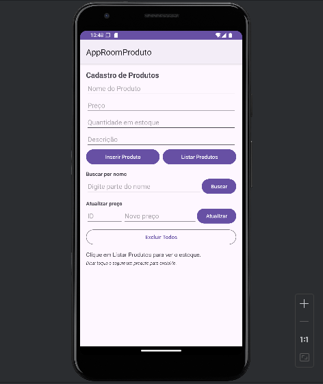
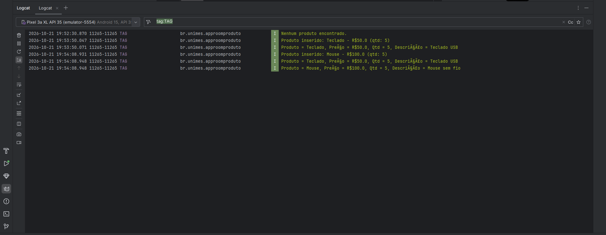

# AppRoomProduto: Cadastro de Produtos com Room SQLite


**Alunos:**
- Marcus Vinicius Motta RA 243439
- Nicholas Correa Fernandes RA 241132

**Disciplina:** Programação para Dispositivos Móveis
**Professor(a):** Alessandro Ferreira Paz de Lima

## Sobre o projeto
Aplicativo Android em Kotlin que cadastra e lista produtos
usando persistência local com Room (SQLite).

## Tecnologias
- Kotlin
- Room 2.6.1 (SQLite)
- ViewBinding
- Corrotinas (lifecycleScope)

## Prints do app




## Parte A: Complemento prático

### A1. Limpar campos após inserir
O que foi feito: depois que o produto é salvo no banco, os campos são apagados e o cursor volta para o campo Nome.

Trecho de código:
```kotlin
binding.editProductName.text.clear()
binding.editProductPrice.text.clear()
binding.editProductDescription.text.clear()
binding.editProductQuantity.text.clear()
binding.editProductName.requestFocus()
```
Print: 

### A2. Validação de preço
O que foi feito: o preço é convertido com `toDoubleOrNull()`. Se ficar vazio (null), zero ou negativo, aparece um erro no próprio campo e o produto não é salvo.

Trecho de código:
```kotlin
val price = binding.editProductPrice.text.toString().toDoubleOrNull()

if (price == null || price <= 0) {
    binding.editProductPrice.error = "Informe um preço válido"
    return@setOnClickListener
}
```

Print: 

### A3. Lista na tela
O que foi feito: coloquei um `TextView` (`txtLista`) abaixo dos botões. Ao clicar em Listar Produtos, a lista aparece nele (e continua aparecendo no Logcat também).

Trecho de código:
```kotlin
binding.btnListarProdutos.setOnClickListener {
    lifecycleScope.launch {
        val products = productDao.getAll()
        mostrarLista(products)
    }
}
```
```xml
<TextView
    android:id="@+id/txtLista"
    android:layout_width="match_parent"
    android:layout_height="wrap_content"
    android:paddingTop="16dp"
    android:textSize="16sp" />
```

Print: 

### A4. Total do estoque
O que foi feito: no final da lista aparece a quantidade de produtos e a soma dos preços.

Trecho de código:
```kotlin
val total = products.sumOf { it.price }
texto += "\nQuantidade de produtos: ${products.size}"
texto += "\nSoma dos preços: R$ $total"
```

Print: 


### A5. Buscar por nome
O que foi feito: criei a função `buscarPorNome` no DAO, um campo de busca e o botão Buscar. Uso `%texto%` para achar nomes parecidos.

Trecho de código:
```kotlin
// ProductDao
@Query("SELECT * FROM product WHERE name LIKE :nome")
suspend fun buscarPorNome(nome: String): List<Product>

// MainActivity
binding.btnBuscar.setOnClickListener {
    val texto = binding.editBusca.text.toString()
    lifecycleScope.launch {
        val products = productDao.buscarPorNome("%$texto%")
        mostrarLista(products)
    }
}
```

Print: 


### A6. Excluir produtos
O que foi feito: criei a função `deleteAll` no DAO e o botão Excluir Todos.

Trecho de código:
```kotlin
// ProductDao
@Query("DELETE FROM product")
suspend fun deleteAll()

// MainActivity
binding.btnExcluirTodos.setOnClickListener {
    lifecycleScope.launch {
        productDao.deleteAll()
        binding.txtLista.text = "Todos os produtos foram excluídos."
    }
}
```

Print: 


### A7. Atualizar produto
O que foi feito: o usuário digita o id e o novo preço. O app busca o produto pelo id, troca o preço com `copy()` e salva com a função `@Update`.

Trecho de código:
```kotlin
// ProductDao
@Query("SELECT * FROM product WHERE id = :id")
suspend fun getById(id: Int): Product?

@Update
suspend fun update(product: Product)

// MainActivity
val produto = productDao.getById(id)
if (produto == null) {
    Toast.makeText(this@MainActivity, "Produto não encontrado!", Toast.LENGTH_SHORT).show()
} else {
    productDao.update(produto.copy(price = novoPreco))
}
```

Print: 


### A8. Novo campo na tabela
O que foi feito: adicionei `quantity: Int` na entidade `Product`, um campo Quantidade no layout e mudei a `version` do banco de 1 para 2.

Trecho de código:
```kotlin
@ColumnInfo(name = "quantity") val quantity: Int

@Database(entities = [Product::class], version = 2)
```

**O que aconteceu com os produtos já cadastrados:** eles foram apagados. Como a estrutura da tabela mudou (ganhou uma coluna nova) e a versão subiu, o Room precisaria de uma migração para saber como transformar a tabela antiga na nova. Como não criei nenhuma migração e o projeto usa `fallbackToDestructiveMigration()`, o Room simplesmente apagou o banco antigo e criou um novo do zero, com a coluna `quantity`. Por isso a lista ficou vazia e foi preciso cadastrar os produtos de novo.


Print: 


## Parte B: Questões dissertativas

### B1. O que é persistência de dados? O que aconteceria se os produtos fossem guardados apenas em uma MutableList?
Resposta: Persistência de dados é quando as informações ficam salvas mesmo depois que o app é fechado ou o celular é desligado. No meu projeto, os produtos são gravados em um banco SQLite pelo Room, que fica salvo como um arquivo dentro do celular. Por isso, quando fecho e abro o app e clico em Listar, os produtos continuam lá. Se eu usasse só uma `MutableList` dentro da `MainActivity`, os dados ficariam apenas na memória RAM. Quando o app fosse fechado, ou até quando a tela girasse e a Activity fosse recriada, a lista seria perdida e todos os produtos sumiriam.

### B2. Qual é a diferença entre usar o SQLite diretamente e usar o Room? Cite duas vantagens do Room.
Resposta: Usando o SQLite direto com `SQLiteOpenHelper`, eu teria que escrever todos os comandos SQL na mão (CREATE TABLE, INSERT etc.) e também converter cada linha do `Cursor` para um objeto Kotlin, o que dá muito trabalho e é fácil errar. O Room é uma camada em cima do SQLite que faz grande parte disso sozinho. Uma vantagem é que ele verifica as consultas SQL na hora de compilar, então se eu escrever o nome de uma tabela errado o erro aparece antes de rodar o app. Outra vantagem é que ele já converte os resultados direto para objetos, como a `List<Product>` do meu `getAll()`. Ele também tem menos código repetido e funciona bem com corrotinas (`suspend`).

### B3. Explique o papel de Entity, DAO e Database. Como elas se relacionam no seu projeto?
Resposta: A Entity é a classe que vira uma tabela no banco; no meu projeto é a `Product`, e cada atributo (id, name, price, description, quantity) vira uma coluna. O DAO é a interface onde ficam os comandos do banco; no meu caso é o `ProductDao`, com funções como `insertAll`, `getAll`, `buscarPorNome`, `deleteAll` e `update`. O Database é a classe `AppDatabase`, que junta tudo: ela diz quais entidades existem no banco e dá acesso ao DAO pela função `productDao()`. Na `MainActivity` eu crio o banco com `Room.databaseBuilder`, pego o DAO e uso ele para salvar e ler objetos `Product`. Ou seja, o Database cria o banco, o DAO faz as operações e a Entity é o formato dos dados.

### B4. Por que o Android não permite acessar o banco na thread principal? O que é um ANR? Como suspend e lifecycleScope.launch resolvem isso?
Resposta: A thread principal é a que desenha a tela e responde aos toques do usuário. Acessar o banco pode demorar, e se isso for feito nela, a tela fica travada enquanto espera. Se o app ficar travado por cerca de 5 segundos, o Android mostra o ANR (Application Not Responding), aquela mensagem perguntando se você quer fechar o app. Por isso o Room já bloqueia esse acesso e dá erro. No meu projeto as funções do DAO são `suspend`, o que faz o Room executar a consulta em outra thread sem travar a tela. E o `lifecycleScope.launch` cria a corrotina onde essas funções podem ser chamadas, e ela é cancelada sozinha se a Activity for fechada.

### B5. O que faz o fallbackToDestructiveMigration()? Por que é perigoso na Play Store? O que é uma migração?
Resposta: O `fallbackToDestructiveMigration()` faz o Room apagar o banco inteiro e criar de novo quando a versão muda e não existe uma migração definida. Eu vi isso acontecer no item A8: quando adicionei o campo `quantity` e mudei a versão para 2, todos os produtos sumiram. Durante o desenvolvimento isso ajuda, mas em um app publicado na Play Store seria muito perigoso, porque ao atualizar o app os usuários perderiam todos os dados deles. Uma migração (`Migration`) é um código que ensina o Room a passar o banco de uma versão para outra sem perder os dados, por exemplo usando `ALTER TABLE product ADD COLUMN quantity INTEGER NOT NULL DEFAULT 0` para só acrescentar a coluna nova.

### B6. Qual é a vantagem do ViewBinding em relação ao findViewById? Que tipo de erro ele ajuda a evitar?
Resposta: Com o ViewBinding, o Android gera uma classe (no meu caso `ActivityMainBinding`) com todos os componentes da tela, e eu acesso eles direto, como `binding.editProductName`. Com o `findViewById` eu teria que buscar cada componente pelo id e informar o tipo, o que deixa o código maior. A vantagem é que o código fica mais curto e mais seguro. Ele ajuda a evitar erros como `NullPointerException`, que acontece quando se usa um id que não existe naquele layout, e `ClassCastException`, quando se converte o componente para o tipo errado (por exemplo tratar um Button como EditText). Se o id não existir, o erro aparece já na compilação.

### B7. Por que em apps maiores é recomendado criar o banco como Singleton? O que aconteceria se várias telas criassem seu próprio banco?
Resposta: Criar o banco com o Room é uma operação pesada, que gasta memória e tempo. No tutorial o banco é criado dentro da `MainActivity`, o que funciona porque o app só tem uma tela. Em apps maiores, o ideal é ter um Singleton, ou seja, uma única instância do banco que é criada uma vez e usada pelo app inteiro. Se cada tela criasse o seu próprio banco, o app gastaria mais memória, ficaria mais lento e poderiam acontecer problemas de várias conexões abertas no mesmo arquivo ao mesmo tempo. Também poderia acontecer de uma tela não ver na hora os dados que outra tela acabou de salvar.

### B8. Reflexão pessoal: dificuldades e um app real onde o Room seria útil
Resposta: A principal dificuldade que tive foi configurar o Gradle, porque precisei adicionar o plugin `kapt`, ativar o ViewBinding e colocar as dependências do Room, e qualquer coisa errada fazia o projeto não compilar. Resolvi conferindo o passo a passo e clicando em Sync Now e Rebuild Project. Também tive que entender por que os produtos sumiram quando adicionei o campo `quantity`, e descobri que foi por causa do `fallbackToDestructiveMigration()`. Um app real onde o Room seria útil é um app de controle de estoque de uma pequena loja ou mercadinho. Eu usaria uma entidade `Produto` com nome, preço e quantidade, igual a deste projeto, para o dono cadastrar os produtos e ver o total do estoque mesmo sem internet.
